<p align="center">
  
</p>

<h1 align="center">JenaImage</h1>

<p align="center">
  macOS native image viewer built with Swift and AppKit
</p>

<p align="center">
  
  
  
</p>

---

## Features

- **Folder Sidebar** — Register folders and browse the folder tree with hierarchical navigation; media count shown per folder
- **Recursive Browsing** — Toggle in the sidebar header to show every image under the selected folder and all its subfolders as one flat grid
- **Grid / Masonry Browser** — Uniform grid cards by default (reading order stays obvious); switch to original-ratio masonry from the toolbar and the last choice is saved. Rounded cards sit on a light gray canvas whose color and opacity you can set in Preferences, beside a brighter sidebar, with adjustable thumbnail size, an optional transparency checkerboard toggle, filenames, folder navigation, and video play badges
- **Fast Thumbnails** — Visible cells load first in parallel with a skeleton placeholder; thumbnails persist in an on-disk HEIC cache (configurable 500 MB–8 GB) so they appear instantly on relaunch. Evicted iCloud Drive files are never downloaded just to make a thumbnail
- **Image Viewer** — In-panel viewer with zoom, rotate, flip (horizontal/vertical), and thumbnail strip navigation; sidebar syncs to current file
- **Image Info** — `⌘I` shows file size, dimensions, DPI, color space, format, and EXIF camera/GPS data
- **Image Compare** — Select 2–4 images and view them side by side in a separate window with synchronized zoom/pan; swap any pane from a bottom candidate strip
- **Bookmarks** — Bookmark images from anywhere and collect them under a "Bookmarks" section in the sidebar; bookmarked images show a star badge in the grid. Remove, delete, or rename from the bookmark view; missing originals show a placeholder
- **Categories** — Collect images from different folders into named categories without moving originals. Assign one or multiple categories from the grid context menu or image viewer, and switch between folder and category browsing using the sidebar header icons
- **Similar Images** — Right-click an image to search within the current image list locally with Apple Vision Image Feature Print (revision 2). Browse up to 100 nearest matches and add selections to categories; saved features are reused until files or the model version change. No API key or separate model installation.
- **Image Editing** — Crop, resize, canvas size, and color adjustment (brightness/contrast/saturation/highlights/shadows) with undo/redo; EXIF orientation handling and print support
- **Slideshow & QuickLook** — Auto-advancing slideshow and QuickLook preview
- **Video Player** — Play MP4, MOV, M4V, AVI, MKV files inline with AVKit
- **Format Conversion** — Export images to JPEG, PNG, WebP, HEIC, HEIF, AVIF, TIFF, BMP, GIF
- **File Management** — Rename, move, copy, duplicate, delete files with drag-and-drop support; sidebar context menu with Reveal in Finder, Rename, Export, Delete; open any file with a compatible app (or the macOS default app) from the context menu
- **Keyboard Shortcuts** — Full keyboard support for all major operations

## Screenshots

<p align="center">
  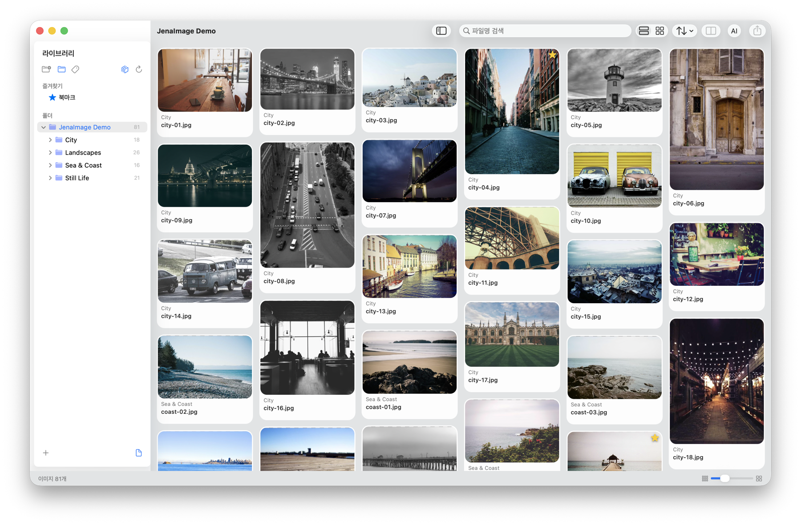
</p>

| Image Viewer | Image Info |
|---|---|
| 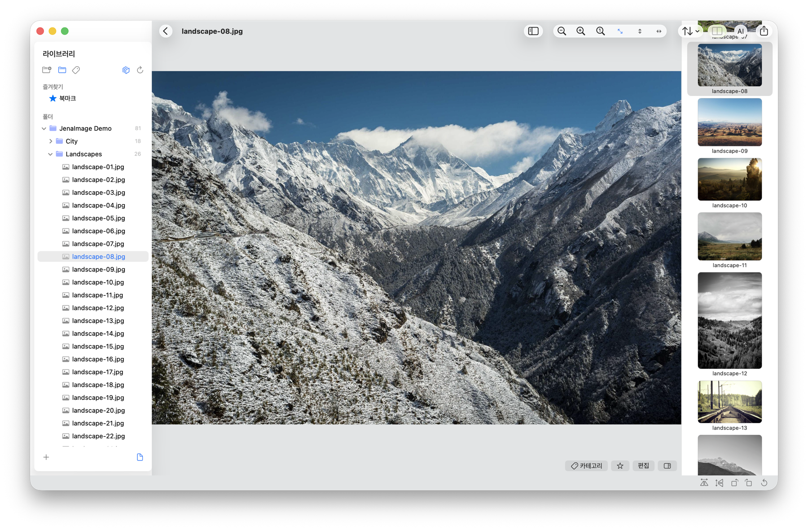 | 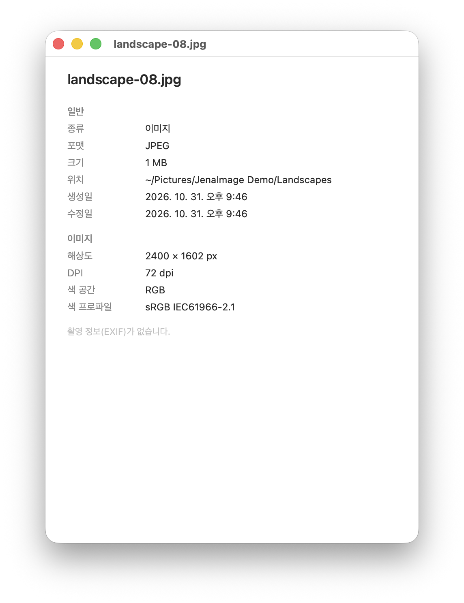 |
| **Image Compare** | **Categories** |
| 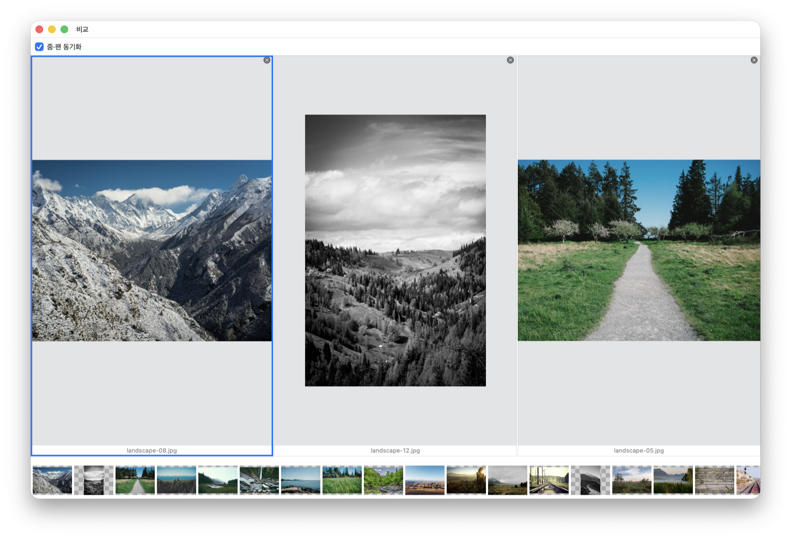 | 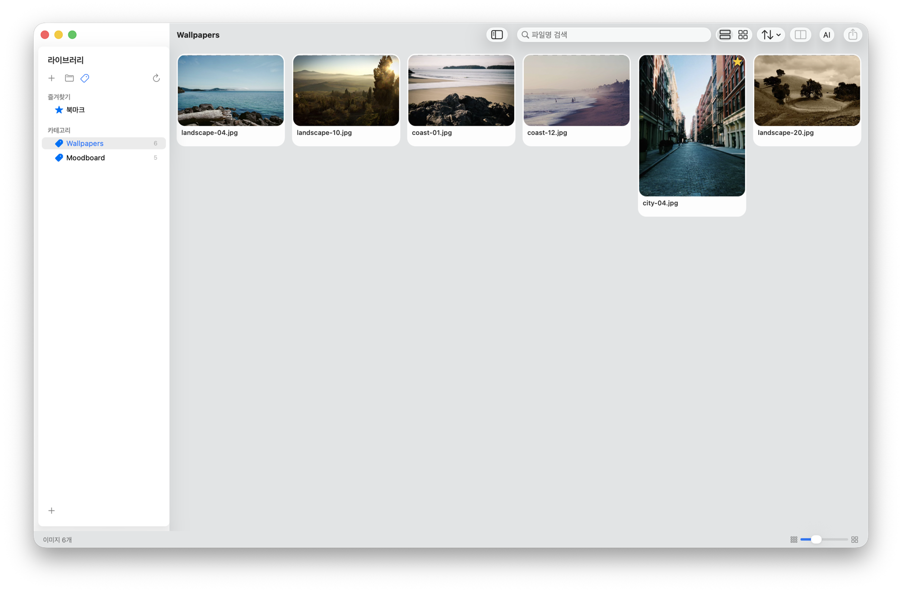 |
| **Similar Images** | **AI Image Chat** |
| 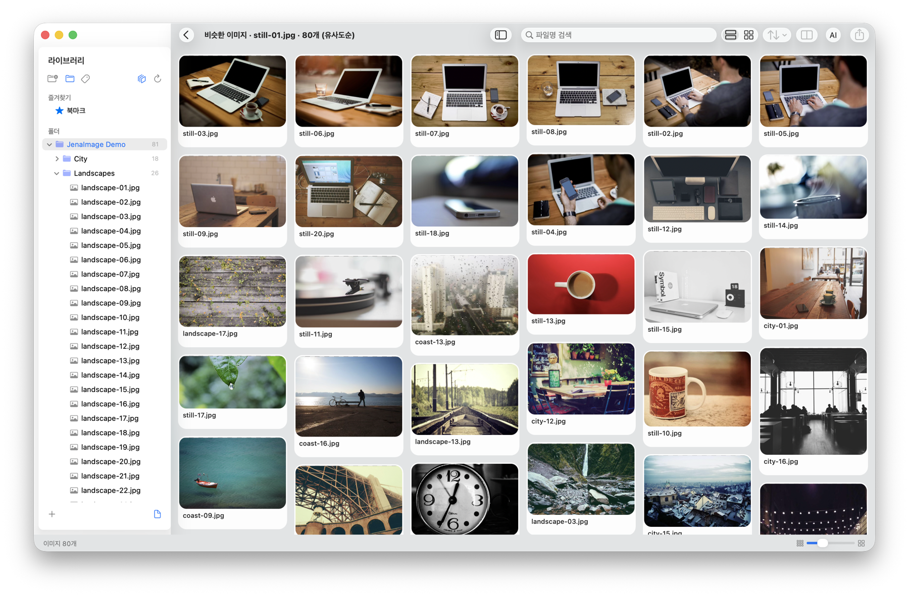 | 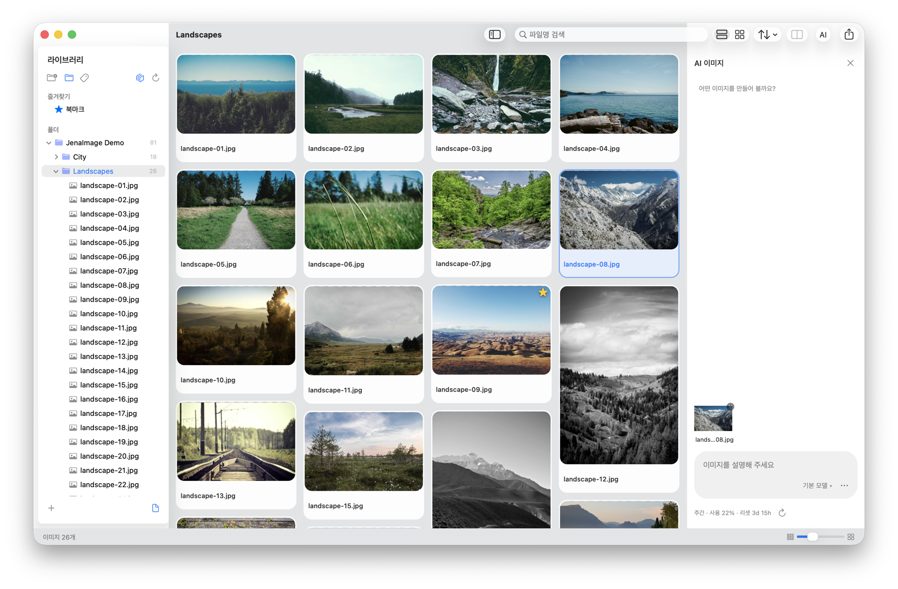 |

### Demo

| Browse & View | Similar Images |
|---|---|
| 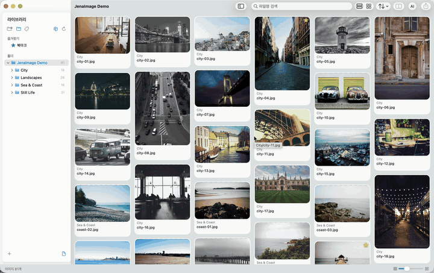 | 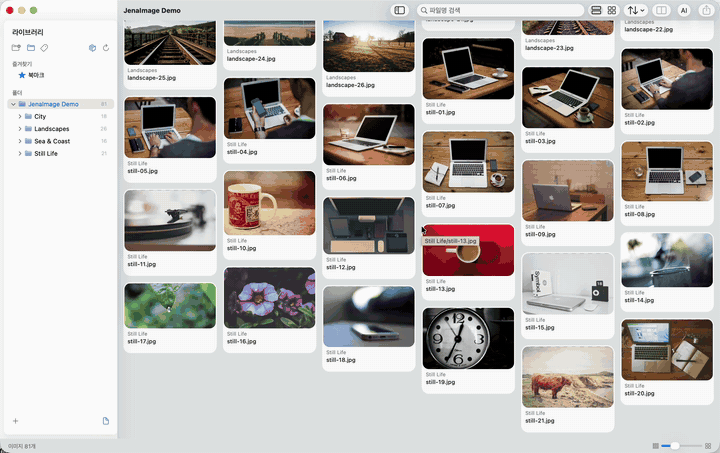 |
| **Compare with synced zoom** | **AI image generation** |
| 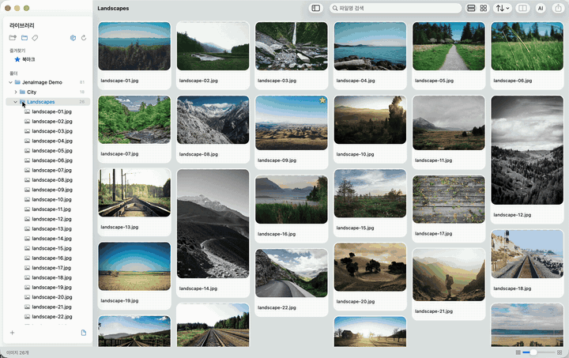 | 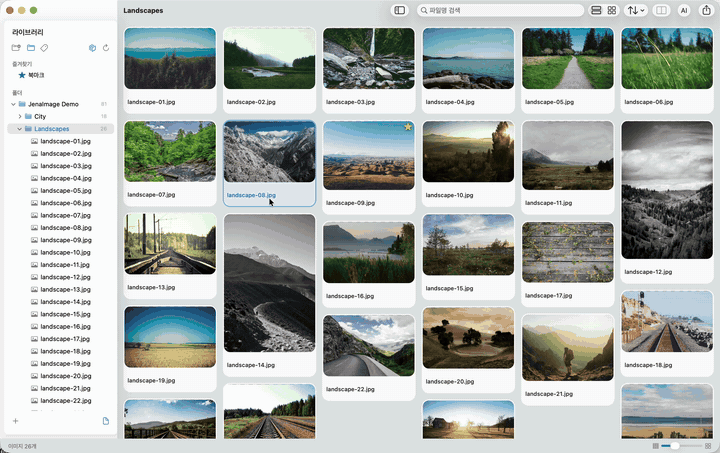 |

The UI is shown in Korean. Demo photos are from [Unsplash](assets/CREDITS.md). The AI demo's waiting time is sped up; actual generation took about two minutes.

## Requirements

- macOS 14.0 (Sonoma) or later

## Build

This project uses a Makefile-based build system — no Xcode project required.

```bash
# Clone
git clone https://github.com/jenalab/jena-image.git
cd jena-image

# Build
make build

# Unit tests and isolated category UI integration tests
make test
make test-ui

# Build and run
make run

# Install to ~/Applications
make install

# Create .pkg installer
make pkg

# Clean build artifacts
make clean
```

## Architecture

Feature-first directory structure with inward dependency flow (UI → Service → Model).

```
Sources/
├── app/          # AppDelegate, MainWindowController, Menus, Toolbar
├── sidebar/      # Folder tree navigation (NSOutlineView)
├── browser/      # Image/folder grid (NSCollectionView)
├── viewer/       # Image display, zoom, thumbnail strip, compare, editor
├── services/     # ImageService, FileService, SecurityScopeService
└── models/       # FolderNode, ImageFile, ImageFormat
```

## Keyboard Shortcuts

| Action | Shortcut |
|--------|----------|
| Add Folder | `⌘O` |
| Save As (Export) | `⇧⌘S` |
| Duplicate | `⌘D` |
| Print | `⌘P` |
| Show Info | `⌘I` |
| Delete | `⌫` |
| Reveal in Finder | `⌘R` |
| Copy to Clipboard | `⌘C` |
| Select All | `⌘A` |
| Compare Selected | `⌘\` |
| Toggle Bookmark | `⌘B` |
| Edit Image | `⌘E` |
| Toggle Sidebar | `⌥⌘S` |
| Back | `⌘[` |
| Previous File (Viewer) | `↑` |
| Next File (Viewer) | `↓` |
| Slideshow | `⌘↩` |
| Zoom In | `⌘+` |
| Zoom Out | `⌘-` |
| Actual Size | `⌘0` |
| Fit to Window | `⌘9` |
| Full Screen | `⌃⌘F` |

## License

MIT License — see [LICENSE](LICENSE) for details.

## Author

[@jenalab](https://www.jenalab.com)
